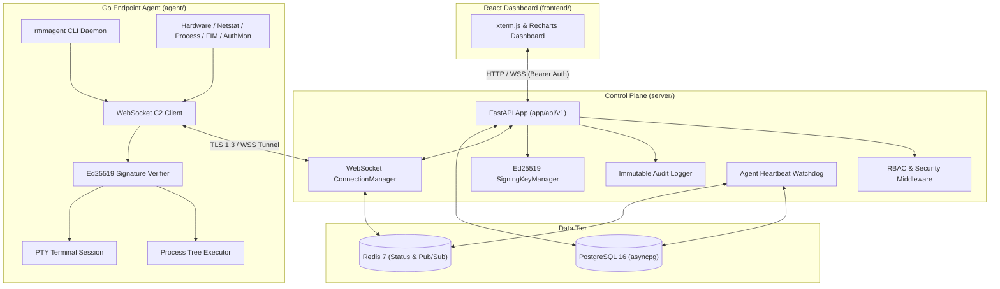

# Tactical RMM Blueprint

## System Overview

Tactical RMM is a high-performance, zero-trust remote monitoring and management platform built with a three-tier architecture:
1. **Endpoint Agent Engine (`agent/`)**: A cross-platform Go daemon deployed onto managed Linux and Windows systems. It executes Ed25519 digitally signed tasks, streams interactive PTY sessions, captures forensic security events, monitors file integrity (FIM), and gathers continuous zero-dependency hardware, process, and socket telemetry.
2. **Control Plane Backend (`server/`)**: An asynchronous FastAPI service backed by PostgreSQL and Redis. It enforces Role-Based Access Control (RBAC), manages multi-tenant organizations and sites, performs cryptographic Ed25519 task dispatch signing, ingests real-time C2 WebSocket telemetry frames, coordinates the agent heartbeat watchdog, and records an append-only, immutable audit trail.
3. **Control Plane Dashboard (`frontend/`)**: A React 19 single-page application built on Vite. It provides operators with live fleet inventory grids, real-time Recharts telemetry visualizations, full-duplex interactive terminal access via xterm.js, software package inspection, RBAC user management, and security audit log exploration.



## Subdirectories & System Boundaries

- **[Agent Engine](./agent/README.md)**: Cross-platform Go endpoint agent engine providing cryptographic enrollment, resilient TLS 1.3 C2 WebSocket tunneling, interactive PTY terminal streaming, hardened OS process tree command execution, and zero-dependency hardware, network, process, forensic event, and file integrity telemetry.
- **[Frontend Dashboard](./frontend/README.md)**: Vite-powered React 19 single-page application delivering fleet inventory inspection, interactive xterm.js terminal sessions, real-time Recharts telemetry charting, anomaly alert triage, software package management, RBAC user administration, and security audit log exploration.
- **[Deployment Scripts](./scripts/README.md)**: Automated cross-platform deployment bootstrap scripts (`install.sh` for Linux and `install.ps1` for Windows) handling binary artifact retrieval, cryptographic SHA-256 verification, secure filesystem staging, initial endpoint enrollment, and background service lifecycle registration.
- **[Control Plane Backend](./server/README.md)**: Python FastAPI backend control plane coordinating REST API endpoints, full-duplex WebSocket tunnels, Ed25519 cryptographic task signing, RBAC authorization, asynchronous PostgreSQL (SQLAlchemy 2.0 / asyncpg) persistence, Redis state caching, and Alembic schema migrations.

## Global Invariants

- **Cryptographic Trust & Non-Repudiation**: All remote task executions and interactive terminal inputs dispatched to agents must be digitally signed with an Ed25519 private key by an authorized operator. Endpoint agents verify signatures, target recipient agent UUID binding, freshness timestamps (maximum 300s clock drift), and anti-replay nonces in constant time prior to execution.
- **Transport Layer Security**: All external communications between dashboard operators, the control plane, and endpoint agents must use TLS (HTTPS / WSS) outside local loopback environments. The Go agent enforces TLS 1.3 as the minimum protocol version and supports custom Root CA certificates, mTLS client keypairs, and leaf/SPKI SHA-256 certificate pinning.
- **Strict Multi-Tenant Scoping & RBAC**: Every operator request is authenticated and authorized against the role hierarchy (`SuperAdmin`, `SiteTechnician`, `Auditor`). SiteTechnicians are constrained to their assigned `org_id` / `site_id`, while Auditors are strictly prohibited from state mutation or task dispatch across both REST and WebSocket channels.
- **Audit Immutability**: All mutating REST operations and C2 WebSocket task completions automatically generate append-only PostgreSQL `audit_logs` records containing the administrator identity, target agent, command text, client IP, and deterministic SHA-256 output hashes. SQL `UPDATE` and `DELETE` operations on `audit_logs` are intercepted and forbidden at the ORM layer.
- **State Storage Hardening**: Stored cryptographic keys, enrollment credentials, and persistent identity files are restricted to operating-system privilege boundaries (`0600` POSIX permissions on Linux; exclusive `SYSTEM` and `Builtin\Administrators` DACLs on Windows).

## Global Side Effects

- **PostgreSQL Database**: Maintains persistent relational state for organizations, sites, agents, enrollment tokens, script templates, installed software catalogs, operator accounts, and immutable audit logs.
- **Redis In-Memory Tier**: Tracks real-time agent connectivity status with TTL leases, caches recent telemetry frames (heartbeat, hardware, network), and routes cross-worker C2 messages over Pub/Sub channels (`c2:agent:*:inbox` and `c2:operator:*:inbox`).
- **Endpoint Operating System Mutating Actions**: The Go agent and bootstrap scripts create and manage OS service supervisor registrations (Linux `systemd` unit files and Windows Service Control Manager services), spawn child shell processes (`/bin/bash` or `powershell.exe`), allocate pseudoterminal devices, and read host system virtual files (`/proc/*`) and Win32 event logs.

## System Verification

To execute test suites across the monorepo components:

```bash
# 1. Verify Go Agent engine test suite
cd agent && go test -v ./...

# 2. Verify Backend Control Plane test suite
cd server && pytest -v

# 3. Verify Frontend Dashboard build
cd frontend && npm run build
```
